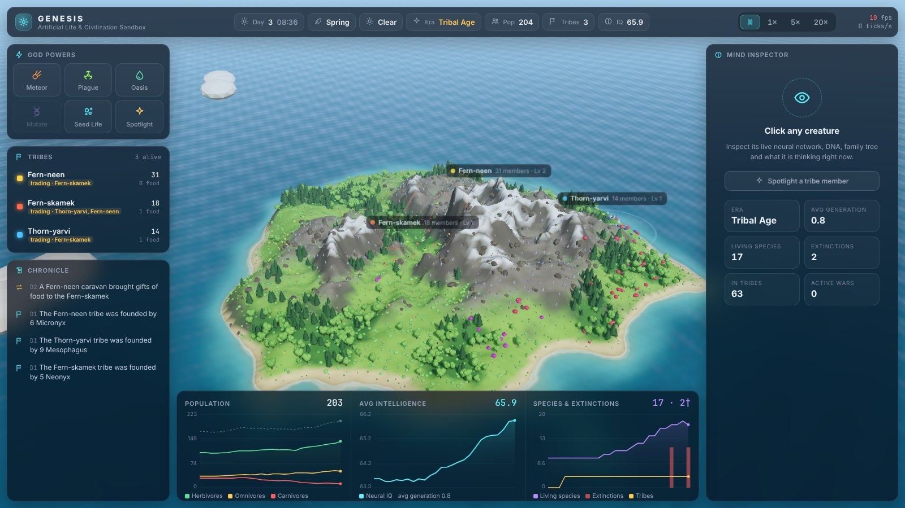
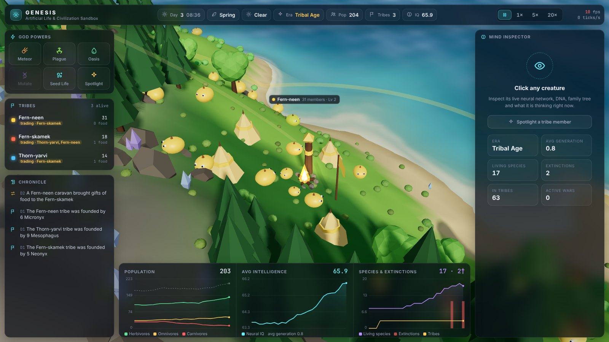
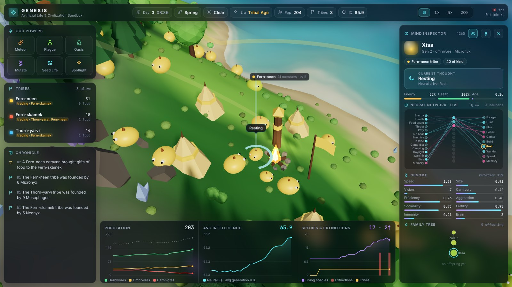
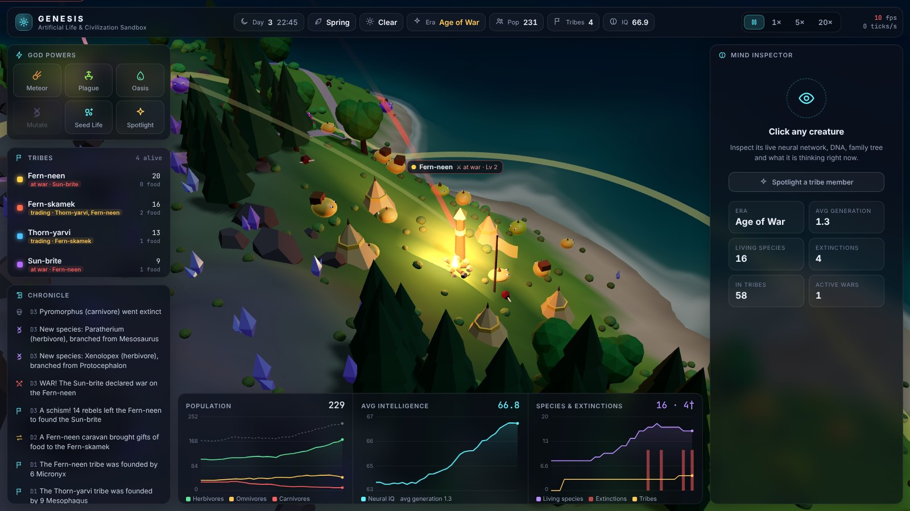
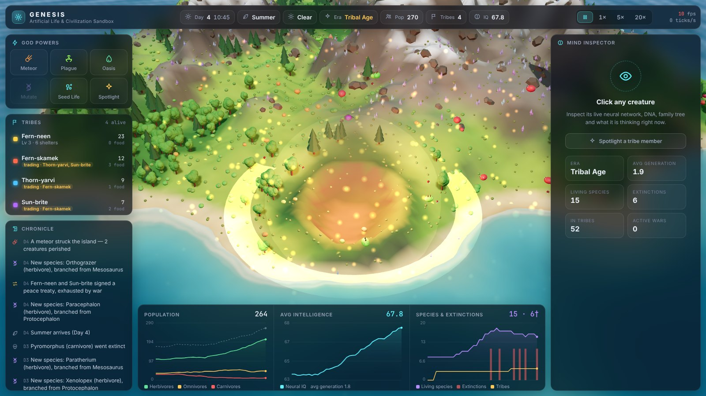
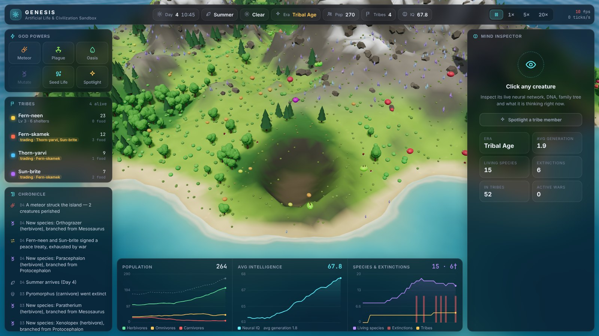
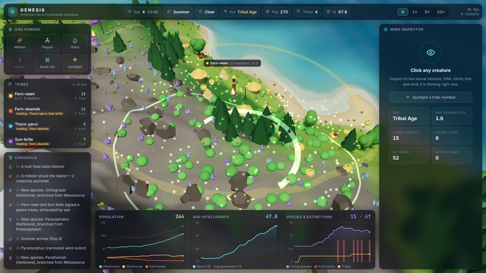
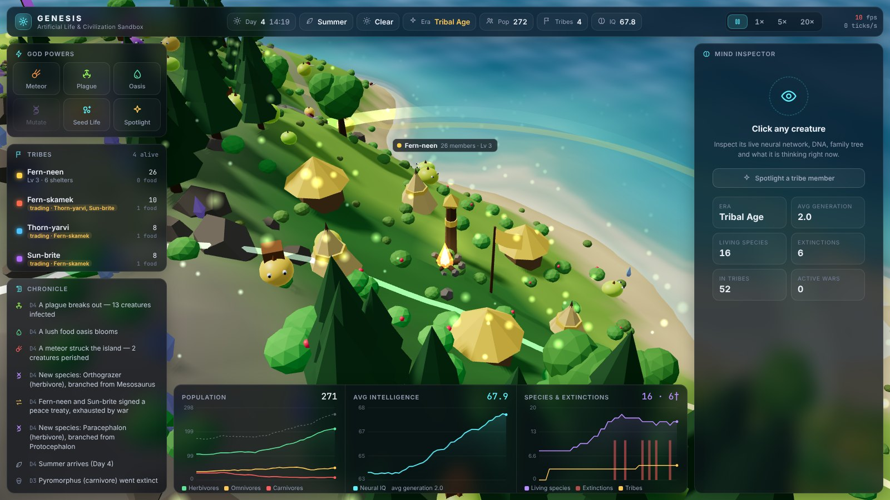

# Genesis: Artificial Life & Civilization Sandbox

A real-time 3D artificial-life sandbox that runs in the browser. Creatures controlled by neural networks start as near-mindless primordial cells on a procedurally generated island. Over generations they evolve into named tribes that build campfires and shelters, store food for winter, farm the land around their camps, defend their territory, trade, split into rival factions and go to war.



| Tribe camp | Neural inspector | Night |
|---|---|---|
|  |  |  |

| Meteor impact | Crater | Oasis | Plague |
|---|---|---|---|
|  |  |  |  |

## Run it

```bash
npm install
npm run dev        # http://localhost:5173  (add ?seed=1337 for another island)
npm run build      # production build in dist/
```

**Controls:**
- Drag to orbit, scroll to zoom, right-drag to pan.
- Click a creature to inspect it. `F` follows it with the camera, `Esc` closes the inspector.
- `Space` pauses. `1`, `2` and `3` switch between 1×, 5× and 20× speed.
- God powers that need a target (Meteor, Plague, Oasis, Seed Life) wait for a click on the island. Shift-click keeps the power armed for repeated use.
- Click a tribe or an event in the chronicle to fly the camera there.

## Architecture

```
src/sim/            pure JS simulation (no DOM) – runs in a Web Worker and under Node
  simulation.js     world clock, seasons, weather, resources, creature AI, god powers, telemetry
  brain.js          neural net: 14 inputs -> up to 12 hidden (tanh) -> 10 outputs, recurrent memory
  genome.js         DNA traits, mutation, crossover, genetic distance / speciation
  tribes.js         tribe formation, camps, farming, recruitment, schisms, diplomacy, war, trade
  terrain.js        seeded island heightmap + biomes (shared by worker and renderer)
src/worker.js       fixed-rate sim loop (20 ticks/s × speed) that streams compact Float32 snapshots
src/render/         Three.js scene: sky/day-night, terrain + water shader, instanced creatures,
                    resources, camps, weather, god-power effects
src/ui/             dark-glass HUD: top bar, god powers, tribes, chronicle, telemetry charts, inspector
scripts/            headless-sim.mjs (ecosystem verification), visual-check.mjs (Playwright)
```

**How it stays fast.** The simulation runs in a worker, so the main thread never steps it. Each frame, the main thread only:
- interpolates creature snapshots,
- writes about 7 instanced matrices per creature,
- draws about 80 batched draw calls.

At 20× speed the worker steps 400 ticks/s within a 22 ms budget per loop. If it falls behind, it drops the backlog rather than stalling the renderer.

### Creatures
- **DNA:** speed, size, vision, diet (herbivore ↔ omnivore ↔ carnivore), efficiency, aggression, sociability, fertility, immunity, hue, mutation rate, brain size, and all of the neural weights.
- **Reproduction:** sexual (crossover) when a ready mate is near, budding otherwise. Every child is mutated. The mutation rate itself evolves.
- **Brain:** every creature senses energy, health, food scent, threats, prey, kin, enemies, tribe status, distance to camp, cargo, daylight, warmth and its own memory. The network picks a drive (Forage, Hunt, Flee, Socialize, Gather, Build, Rest or Wander) and modulates speed.
  - A civilization layer adds situational actions on top: war, defending, trading, courting, hoarding, feasting from stores.
  - The inspector shows both the neural drive and the action actually taken.
- **Intelligence:** a creature can found a tribe only with at least 4 hidden neurons. Larger brains forage and fight better but cost energy. Eye size grows with brain size, so you can watch "cells" turn into big-eyed thinkers.
- **Ecology:**
  - Predators tire after a 70-tick chase and are territorial.
  - Prey herds raise the alarm together.
  - Hungry bodies slow their metabolism (torpor), and winter rest acts as hibernation.
  - Plant-eaters only breed when the local pasture can feed their young.
  - These rules produce lagged predator-prey cycles instead of boom-and-bust extinctions.

### Tribes
Social, smart creatures with similar DNA that stay together for about 80 ticks found a named tribe with its own color. Tribes then:
- **Build their camp:** a campfire on day one, then tents, huts, a totem, a palisade and crates of stored food.
- **Farm:** plants grow faster inside their territory.
- **Survive winter better:** shelters cut the cold, and the tribe raises its young from shared stores.
- **Grow and split:** they recruit like-minded wanderers, and split in a schism once they get too big.

Relations between tribes drift with temperament, overlapping territory and killings. They lead to trade caravans (gold arcs) or wars (red arcs), with raids on enemy stores, war weariness and peace treaties.

### God powers
- **Meteor:** deforms the terrain into a scorched crater, flattens trees, kills nearby creatures and leaves mineral-rich ground.
- **Plague:** a contagious disease that spreads by proximity and is resisted by immunity genes.
- **Food oasis:** a patch of lush plant growth that lasts a while.
- **Mutate:** a strong mutation on the selected creature.
- **Seed Life:** drops new primordial cells.
- **Spotlight:** picks a tribe member to inspect.
- **Speed:** 1×, 5× or 20×.

## Verification

### 1. Headless ecosystem test

`npm run sim:test` runs 6 seeds for 5,000 ticks each. Options: `--ticks=`, `--seeds=`, `--every=`. Full output: [`artifacts/headless-report.txt`](artifacts/headless-report.txt).

| seed | min pop | max pop | 1st tribe | tribes founded | wars | trades | avg gen | predator lag (ticks) |
|---|---|---|---|---|---|---|---|---|
| 42 | 163 | 359 | tick 80 | 7 | 5 | 4 | 4.4 | 450 |
| 7 | 165 | 350 | tick 80 | 7 | 5 | 15 | 3.5 | 1500 |
| 1337 | 157 | 387 | tick 80 | 10 | 8 | 14 | 3.8 | 1150 |
| 99 | 161 | 510 | tick 80 | 13 | 13 | 62 | 5.6 | 1000 |
| 2024 | 156 | 221 | tick 80 | 5 | 1 | 10 | 4.0 | 900 |
| 5 | 157 | 329 | tick 80 | 11 | 3 | 36 | 4.0 | 1500 |

On every seed:
- The population never collapses (minimum population of at least 40).
- Plant-eaters and predators both persist.
- A tribe forms within 1,000 ticks.
- At least two tribes are founded.
- Tribes go to war or trade.
- The population evolves (average generation of at least 2).
- Prey and predator numbers cycle (the series reverse direction repeatedly).

Predator lag is the offset at which predator numbers best track prey numbers. The correlation at that lag is strong for seeds 42, 7 and 1337 (0.76–0.91) and weak or negative for 99, 2024 and 5, so a clean predator-follows-prey lag shows up on only half the seeds.

Longer runs (`--ticks=10000`) show the cycles continuing through the harsh winters. They are not part of the pass criteria: in earlier tuning rounds some seeds briefly dipped below these thresholds over 8,000 ticks.

### 2. Visual check in a real browser

`npm run build && npm run visual:check` serves the build, opens it in headless Chromium (WebGL 2 through SwiftShader) and fast-forwards evolution by 1,000 ticks.

It then freezes the world and takes screenshots:
- orbit view
- tribe camp close-up
- neural inspector
- night camp
- meteor impact
- crater
- oasis
- plague

It fails the run on any of these:
- WebGL or console errors, or a lost context
- overlapping or off-screen HUD panels
- clipped labels

Output is saved in `artifacts/`. The report is also run at 1280×720 with `--width=1280 --height=720`.

Each run also checks the layout at 1280×720 (`--width=1280 --height=720`). Example: [neural inspector at 1280×720](docs/screenshots/03-neural-inspector-1280x720.jpg).

### 3. Main-thread performance probe

`npm run perf:probe` skips the GPU rasterisation step and measures the JavaScript we run on each frame at real `requestAnimationFrame` cadence. It also records the worker's tick rate. Output: [`artifacts/perf-probe.txt`](artifacts/perf-probe.txt).

| speed | creatures | main-thread JS per frame (median / p95 / max) | worker ticks/s |
|---|---|---|---|
| 1× | 225 | 1.3 / 3.2 / 14.4 ms | 20 (target 20) |
| 20× | 281 | 2.7 / 6.9 / 13.6 ms | 400 (target 400) |

The scene uses about 55–120 draw calls, depending on how many camps are visible. Static camp geometry is merged per material, and creatures, plants, crystals and trees are all instanced.

**Not verified: true 60 FPS.** This container has no GPU. Headless Chromium draws WebGL with SwiftShader on the CPU, so the in-app FPS counter in the screenshots reads about 10 fps. That is the software rasteriser's limit, not the app's. What the numbers do show is that our per-frame JavaScript leaves most of the 16.7 ms budget free, and that the worker holds the full 20× tick rate.
