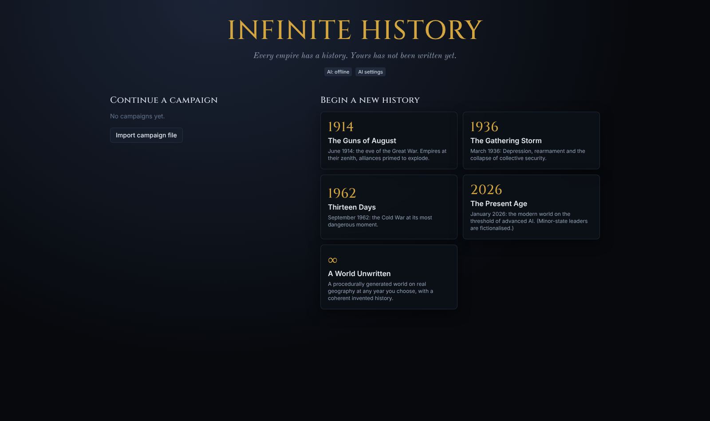
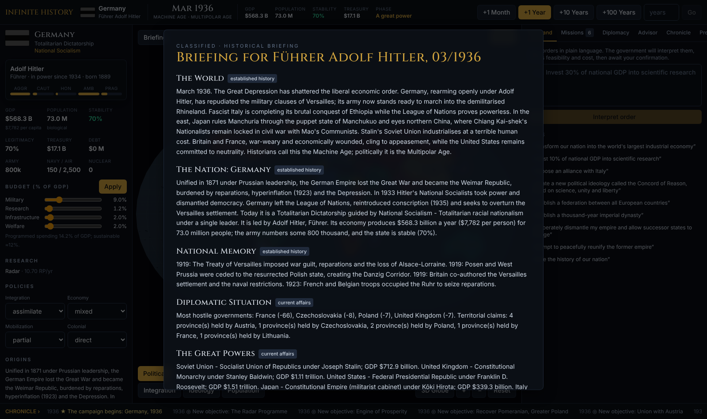
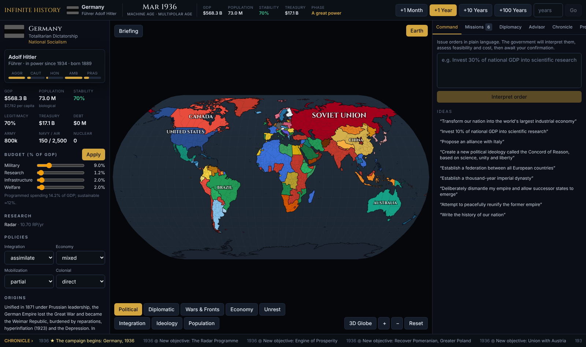
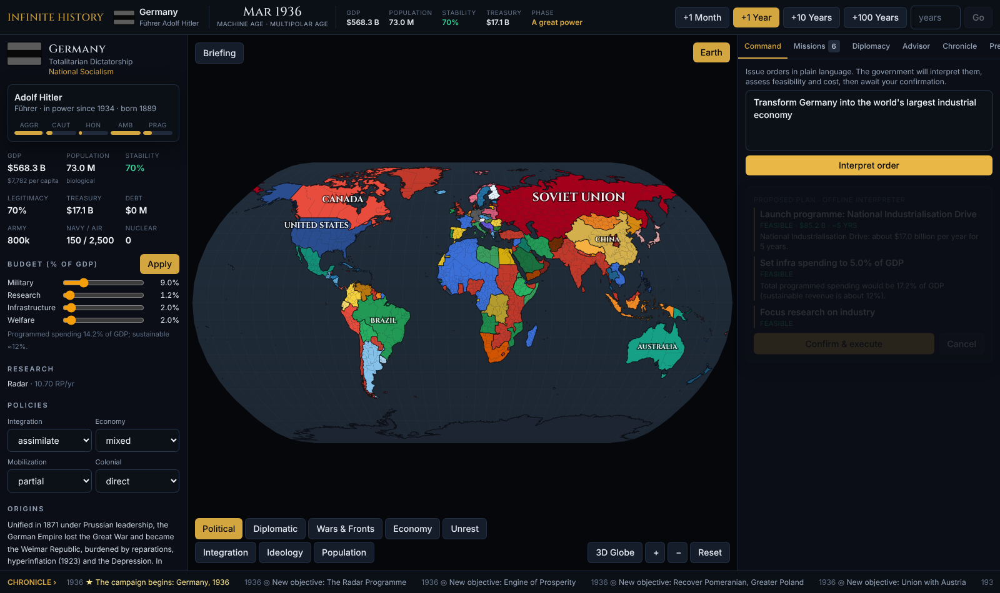
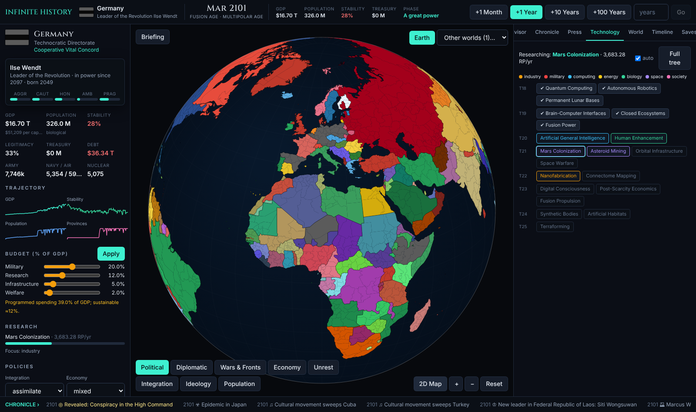
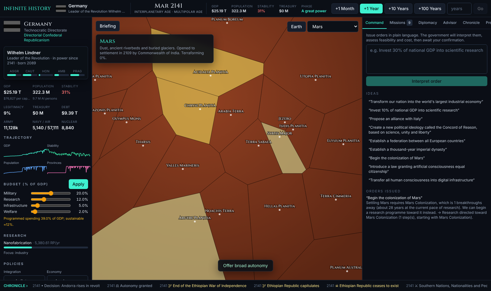
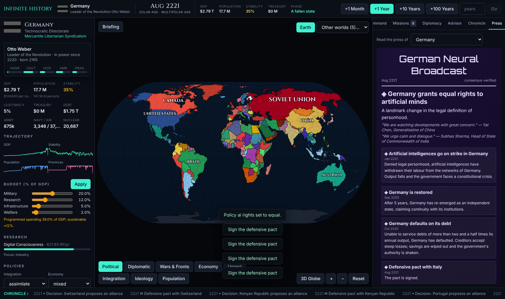
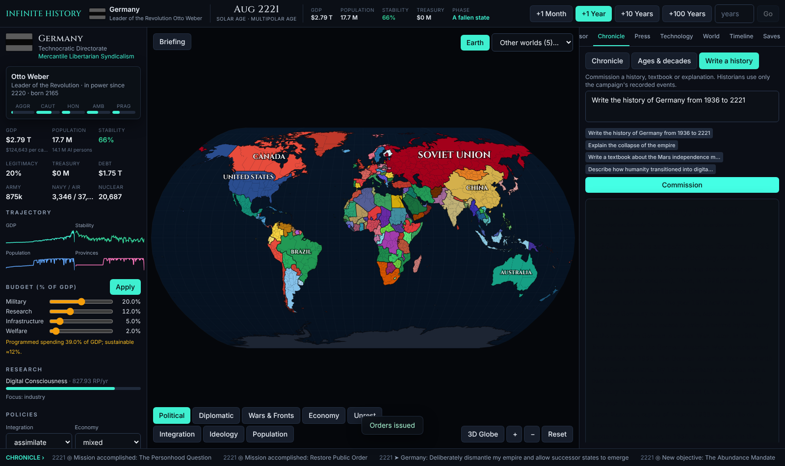

# INFINITE HISTORY

An AI-driven alternate-history sandbox. Pick any year and any nation, give orders in plain language, and let a
persistent, self-remembering world respond — from 1936 to the post-biological future and beyond.

It runs without any API key. A deterministic simulation drives the world, and an offline storyteller writes
every briefing, newspaper, mission and history from the campaign's own records. If you connect a language
model (Anthropic Claude, a local Ollama model, or any OpenAI-compatible endpoint), it adds richer
interpretation and prose. Everything the model proposes is validated before it can touch the world state.

## Quick start

```bash
# backend (Python 3.11+)
cd backend
python -m venv .venv && .venv/bin/pip install -r requirements.txt
# frontend (Node 20+)
cd ../frontend && npm install && npm run build
# run (serves the built UI and the API on one port)
cd ../backend && .venv/bin/uvicorn app.main:app --port 8000
# open http://localhost:8000
```

For frontend development, run `npm run dev` in `frontend/` (port 5173). It proxies `/api` to the backend on port 8000.

The game saves campaigns to `backend/data/infinite_history.db` (SQLite). To use a different file, set `IH_DB`.

### Optional AI provider

Open **AI settings** on the main menu, or set environment variables before starting the server:

| Provider | Settings |
|---|---|
| Offline (default) | nothing to configure |
| Anthropic Claude | `IH_AI_PROVIDER=anthropic`, `ANTHROPIC_API_KEY=...` (default model `claude-opus-5-5`, effort `low`) |
| Ollama | `IH_AI_PROVIDER=ollama`, `IH_AI_MODEL=llama3.1`, `IH_AI_BASE_URL=http://localhost:11434` |
| OpenAI-compatible | `IH_AI_PROVIDER=openai`, `IH_AI_BASE_URL=...`, `IH_AI_API_KEY=...`, `IH_AI_MODEL=...` |

You can turn the model on or off per feature: orders, missions, diplomacy, newspapers, chronicle, advisor and
briefing. If the model fails, refuses or returns invalid JSON, the game falls back to the offline generators.

## How to play

1. **Choose a start.** The historical starts are **1914** (the July Crisis), **1936** (the gathering storm),
   **1962** (the Cuban Missile Crisis) and **2026** (the present). You can also generate a **fictional world**
   at any year, from 3000 BCE to the far future. It uses real geography, generated realms and a generated
   history of fallen empires and old wars. You can add a free-text *point of divergence*, such as "Italy is
   allied with France".
2. **Read the briefing.** It separates established history from alternate developments.
3. **Give orders in plain language** in the Command panel, for example "Invest 30% of national GDP into
   scientific research", "Establish a federation between all European countries", "Begin the colonization of
   Mars" or "Deliberately dismantle my empire and allow successor states to emerge". Before you confirm, each
   order shows how feasible it is, what it costs, how long it takes and what follows from it. An order that
   cannot happen yet becomes a long-term programme instead of an instant miracle. For example, Mars in 1936
   becomes a research programme with a time estimate.
4. **Advance time** by 1 month, 1 year, 10 years, 100 years, or any number of years. Time pauses when a
   decision needs you.
5. **Follow the story.** The Missions, Diplomacy, Advisor, Chronicle, Press, Technology, World, Timeline and
   Saves panels show how the world changes around you.

Difficulty: `historical` (default), `easy`, `hard` and `sandbox` (an overwhelming player state for exploring
storylines). To choose one, pass `settings.difficulty` when you create a campaign through the API.

## Architecture

```
backend/app
  world/       real geography (1,401 Natural Earth provinces), scenarios, tech tree, ideologies, name generators
  sim/         deterministic engine: economy, research, military, war & peace, stability/revolts/revolutions,
               leaders & succession, AI states, space colonisation, digital society, successor states
  story/       story director (eras, phases, storylines), adaptive missions, decisions, historical hooks,
               divergence, newspapers, briefings, histories, advisor, diplomacy
  memory/      chronicle store (SQLite + FTS5), decade/century summaries, retrieval
  orders/      offline natural-language interpreter, action schema + feasibility, validated executor
  ai/          provider abstraction (Anthropic SDK, OpenAI-compatible, Ollama, offline) and context builder
  service.py   single gateway: validation, persistence, snapshots, export/import
  main.py      FastAPI routes; also serves the built frontend
frontend/src   React + TypeScript + Tailwind + Framer Motion; canvas map with D3-geo (2D + 3D globe),
               Voronoi planetary maps (Luna, Mars, the Belt, outer moons, exoplanets)
```

### Key design points

- **The simulation is authoritative.** GDP, population, territory, armies, research, wars and treaties are
  computed deterministically from the campaign seed. The same seed gives the same history, independent of
  Python's hash seed. Language models never write to the state directly. They return structured JSON, which
  goes through the same action validator as the offline parser.
- **Adaptive storytelling.** The story director classifies your state's *phase* of history. The phases are
  minor state, regional power, great power, continental empire, planetary hegemon, interplanetary power,
  post-biological civilisation, interstellar civilisation, successor state, and fallen. It also tracks
  *storylines*: wars, resistance movements, succession crises, Earth–Mars tensions, digital-rights and
  AI-personhood movements, rivalries, imperial overstretch, restoration movements and the successor age.
  When the phase changes, missions written for the old situation are superseded.
- **Missions** come from the current phase, the active storylines, your claims, rivals, technology,
  anniversaries of your own history and the aftermath of collapse. Every objective is a machine-checkable
  condition. Missions can be optional, mandatory, hidden (revealed by intelligence) or crises, and they carry
  rewards, failure consequences and deadlines.
- **Persistent memory.** Every event goes into a full-text-indexed chronicle. Completed decades and centuries
  are compressed into summaries. Retrieval combines BM25, importance, entity matching and anniversary
  awareness, so a 300-year-old treaty can still shape a negotiation today. Each nation keeps its own memories
  (invasions, betrayals, lost provinces, aid). They fade with configurable half-lives, but deep grievances
  never fade completely.
- **An open-ended future.** The authored tech tree runs from agriculture to spacetime metric engineering.
  Past that, the game generates new technologies forever. Eras are named after what the world has actually
  achieved. New ideologies emerge from crises, colonial independence and the post-biological transition.

## Tests

```bash
cd backend && .venv/bin/python -m pytest -q        # 49 tests, including the full demonstration campaign (~2 min)
cd frontend && npx vitest run                       # 11 unit tests
cd frontend && npx playwright test --trace off      # 9 end-to-end steps of a campaign in a real browser (run `npm run build` first)
```

The demonstration campaign test (`backend/tests/test_demo_campaign.py`) plays Germany from 1936. It
industrialises, expands, reaches global dominance, advances two centuries, establishes a planetary government,
reaches Mars (by settlement, or by force if others claimed it first), develops digital consciousness and
faces Earth–Mars tensions. It then receives a new set of missions, dismantles the empire into successor
states, and checks that the chronicle still holds everything back to 1936.

## Screenshots

| | |
|---|---|
|  |  |
|  |  |
|  |  |
|  |  |

## Data sources

Province geometry comes from [Natural Earth](https://www.naturalearthdata.com/) admin-1 states/provinces
(public domain). It is grouped into game provinces by `tools/geo/`. Historical figures for 1914, 1936 and 1962
are approximations from standard references (Maddison Project GDP per capita and contemporary force levels).
In the 2026 scenario, leaders of minor states are fictionalised.
