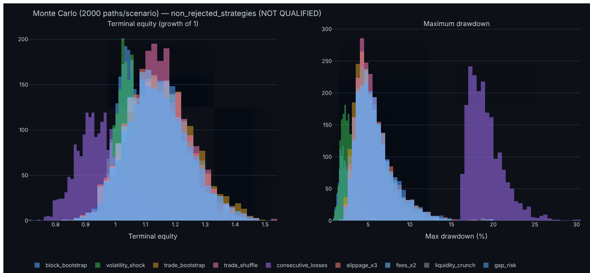

# Monte Carlo Stress-Test Report

Portfolio simulated: **non_rejected_strategies** = breakout (NOT QUALIFIED — no strategy was promoted; simulated to characterise risk only).

Paths per scenario: 2000, seed 20240601, horizon ≈ 1 year (365 days / 99 trades). Ruin = equity ≤ 50% of start; daily breach = a day (or trade) losing ≥ 3%; total breach = drawdown ≥ 10%.

> Monte Carlo resamples *historical OOS* outcomes under explicit assumptions. It does not guarantee future results.

> **Two risk scales.** Daily-return scenarios (`block_bootstrap`, `volatility_shock`) resample the *integrated portfolio as simulated* (regime-weighted allocations, circuit breakers on). Trade-level scenarios resample the member strategies' *standalone* OOS trades at the full 1% risk per trade (divided by the number of members when there are several), so they show larger dispersion than the allocated portfolio would.

| scenario | terminal_equity_median | terminal_equity_p05 | terminal_equity_p95 | max_drawdown_median | max_drawdown_p95 | prob_daily_dd_breach | prob_total_dd_breach | prob_ruin | prob_loss |
|---|---|---|---|---|---|---|---|---|---|
| block_bootstrap | 1.044 | 0.983 | 1.133 | 2.32% | 4.41% | 0.00% | 0.00% | 0.00% | 13.55% |
| volatility_shock | 1.044 | 0.979 | 1.141 | 2.65% | 5.01% | 0.00% | 0.00% | 0.00% | 15.50% |
| trade_bootstrap | 1.158 | 1.003 | 1.342 | 4.82% | 9.14% | 0.00% | 3.30% | 0.00% | 4.65% |
| trade_shuffle | 1.158 | 1.023 | 1.324 | 4.93% | 8.59% | 0.00% | 1.85% | 0.00% | 2.05% |
| consecutive_losses | 0.939 | 0.827 | 1.072 | 18.69% | 22.97% | 0.00% | 100.00% | 0.00% | 78.85% |
| slippage_x3 | 1.124 | 0.975 | 1.303 | 5.36% | 10.38% | 0.00% | 6.30% | 0.00% | 8.75% |
| fees_x2 | 1.126 | 0.977 | 1.305 | 5.32% | 10.28% | 0.00% | 6.15% | 0.00% | 8.40% |
| liquidity_crunch | 1.143 | 0.990 | 1.322 | 5.07% | 9.79% | 0.00% | 4.60% | 0.00% | 6.45% |
| gap_risk | 1.141 | 0.984 | 1.326 | 5.39% | 10.34% | 1.05% | 6.10% | 0.00% | 7.25% |

Scenario definitions:
* **block_bootstrap** — stationary block bootstrap of 1462 OOS daily returns, mean block 10
* **volatility_shock** — block bootstrap with 1.75x dispersion in one random 30-day block per path
* **trade_bootstrap** — iid bootstrap of 397 OOS trade returns
* **trade_shuffle** — random permutation of trade order
* **consecutive_losses** — bootstrap with an injected streak of 20 worst-5% losses
* **slippage_x3** — slippage+spread cost tripled (extra 2x charged)
* **fees_x2** — fees doubled
* **liquidity_crunch** — +25 bps per side on a random 20% of trades
* **gap_risk** — 3% of losing trades gap through the stop to 3x their loss

