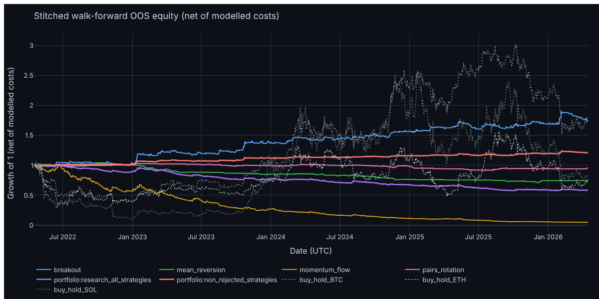
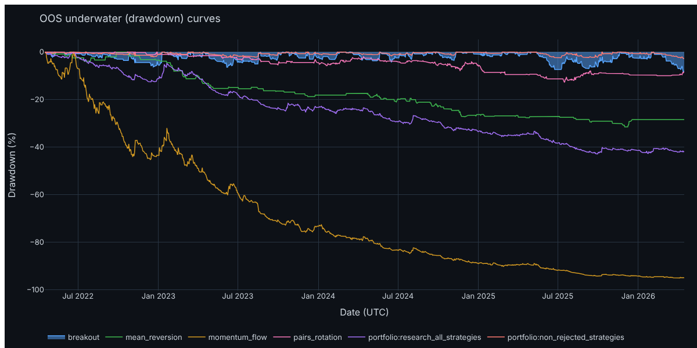
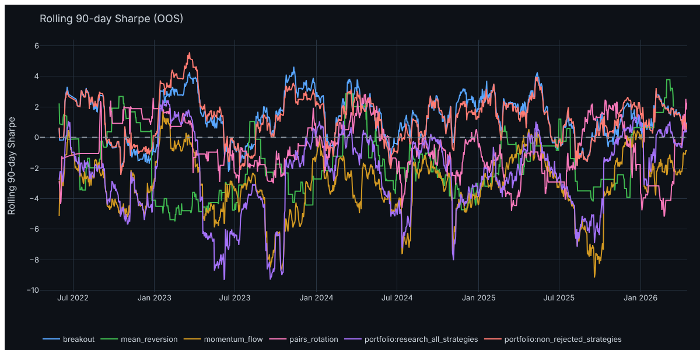
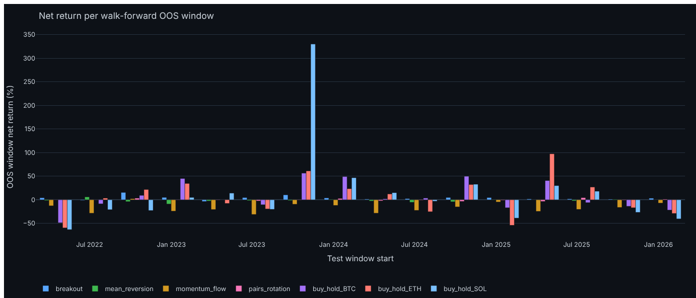

# Walk-Forward Out-of-Sample Performance Report

Generated 2026-11-22T14:42:34.625289+00:00 · config hash `31c941f7f63244f8` · total configurations tested across all strategies: **96**

> All figures are **out-of-sample**, net of modelled fees (0.10% taker/maker assumption), spread, volatility/impact slippage and funding. Each walk-forward window starts from a flat book with the same capital; windows are stitched by compounding daily returns. Annualisation uses 365 days. These are simulations under stated assumptions, not predictions.

## Data and windows

* Data: 2021-01-02 00:00:00+00:00 → 2026-11-22 12:30:00+00:00 (Binance spot OHLCV via data-api.binance.vision; funding from Binance USD-M archives + OKX for the current month).
* Stitched OOS span: 2022-04-16 00:00:00+00:00 → 2026-04-16 00:00:00+00:00 (**4.00 years**, 16 windows).
* Final holdout (untouched until decisions were frozen): 2026-05-22 00:00:00+00:00 → 2026-11-22 12:30:00+00:00; evaluated 2 time(s).

## Promotion decisions

| strategy | status | failed checks |
|---|---|---|
| breakout | RESEARCH_ONLY | deflated_sharpe |
| mean_reversion | REJECTED | sharpe_ci_lower, deflated_sharpe, max_drawdown, positive_windows, profit_factor, cost_stress |
| momentum_flow | REJECTED | sharpe_ci_lower, deflated_sharpe, max_drawdown, positive_windows, profit_factor, cost_stress |
| pairs_rotation | REJECTED | sharpe_ci_lower, deflated_sharpe, pbo, positive_windows, profit_factor, cost_stress |

**Deployable (PROMOTED) strategies: NONE — no validated deployable strategy exists.**

## Strategy OOS metrics (stitched)

| metric | breakout | mean_reversion | momentum_flow | pairs_rotation |
|---|---|---|---|---|
| net_return | 74.61% | -25.37% | -94.95% | -4.57% |
| annualized_return | 14.94% | -7.05% | -52.58% | -1.16% |
| annualized_volatility | 11.41% | 4.93% | 25.05% | 4.21% |
| sharpe | 1.28 | -1.46 | -2.85 | -0.26 |
| sharpe_ci_lower | 0.25 | -2.64 | -4.00 | -1.18 |
| sharpe_ci_upper | 2.20 | -0.26 | -1.76 | 0.58 |
| sortino | 2.32 | -1.90 | -4.06 | -0.39 |
| calmar | 1.74 | -0.22 | -0.55 | -0.09 |
| max_drawdown | 8.58% | 31.50% | 95.13% | 12.69% |
| average_drawdown | 1.89% | 17.69% | 35.69% | 2.65% |
| win_rate | 40.81% | 34.38% | 35.56% | 46.25% |
| profit_factor | 1.53 | 0.53 | 0.73 | 0.94 |
| avg_win | 1,067 | 696 | 830 | 615 |
| avg_loss | -480 | -692 | -629 | -564 |
| expectancy | 151 | -215 | -110 | -19 |
| total_trades | 397 | 128 | 2500 | 240 |
| turnover_annualized | 28.9x | 23.4x | 534.8x | 18.1x |
| exposure_time_fraction | 50.29% | 4.49% | 19.19% | 33.15% |
| avg_gross_exposure | 0.12 | 0.02 | 0.12 | 0.08 |
| avg_holding_hours | 79.4 | 15.5 | 3.9 | 82.0 |
| trading_costs | 20,129 | 15,066 | 378,329 | 11,835 |
| fees | 11,574 | 9,391 | 214,197 | 7,232 |
| slippage_cost | 6,088 | 6,092 | 163,295 | 4,366 |
| funding | 2,467 | -418 | 836 | 237 |
| recovery_factor | 4.57 | -0.77 | -0.98 | -0.35 |
| dsr | 0.881 | 0.000 | 0.000 | 0.001 |
| pbo | 0.043 | 0.167 | 0.000 | 0.526 |
| positive_window_fraction | 87.50% | 18.75% | 6.25% | 31.25% |
| stress_net_return | 47.19% | -36.23% | -99.92% | -14.91% |
| oos_days | 1462 | 1462 | 1462 | 1462 |

## Combined portfolio (integrated 15m simulation, regime allocator, circuit breakers enforced)

**research_all_strategies** — net -41.35%, CAGR -12.48%, Sharpe -2.00 (95% CI -3.37…-0.86), max DD 42.90%, trades 3329, positive windows 25%.

| window | test_start | net_return | sharpe | max_drawdown | total_trades | breaches |
|---|---|---|---|---|---|---|
| 0 | 2022-04-16 | -2.79% | -1.82 | 3.88% | 141 | - |
| 1 | 2022-07-16 | -6.11% | -4.30 | 7.53% | 219 | - |
| 2 | 2022-10-16 | 4.27% | 1.87 | 3.67% | 210 | - |
| 3 | 2023-01-16 | -8.07% | -4.41 | 8.37% | 258 | - |
| 4 | 2023-04-16 | -7.43% | -5.34 | 8.64% | 209 | - |
| 5 | 2023-07-16 | -7.54% | -9.07 | 7.58% | 141 | - |
| 6 | 2023-10-16 | 0.98% | 0.51 | 5.84% | 240 | - |
| 7 | 2024-01-16 | 0.18% | 0.15 | 3.31% | 183 | - |
| 8 | 2024-04-16 | -8.63% | -6.74 | 9.45% | 235 | - |
| 9 | 2024-07-16 | -3.81% | -2.27 | 7.41% | 240 | - |
| 10 | 2024-10-16 | -3.22% | -2.16 | 3.85% | 264 | - |
| 11 | 2025-01-16 | -1.06% | -0.82 | 3.22% | 190 | - |
| 12 | 2025-04-16 | -6.64% | -3.45 | 9.02% | 227 | - |
| 13 | 2025-07-16 | -2.07% | -0.99 | 7.37% | 206 | - |
| 14 | 2025-10-16 | -2.93% | -2.72 | 3.80% | 197 | - |
| 15 | 2026-01-16 | 0.61% | 0.36 | 3.36% | 169 | - |

**non_rejected_strategies** — net 20.95%, CAGR 4.87%, Sharpe 1.27 (95% CI 0.26…2.19), max DD 2.75%, trades 398, positive windows 81%.

| window | test_start | net_return | sharpe | max_drawdown | total_trades | breaches |
|---|---|---|---|---|---|---|
| 0 | 2022-04-16 | 1.40% | 1.99 | 0.69% | 14 | - |
| 1 | 2022-07-16 | -0.32% | -0.55 | 1.29% | 19 | - |
| 2 | 2022-10-16 | 5.97% | 3.47 | 2.18% | 30 | - |
| 3 | 2023-01-16 | 1.87% | 2.03 | 1.17% | 24 | - |
| 4 | 2023-04-16 | -1.51% | -1.95 | 2.05% | 32 | - |
| 5 | 2023-07-16 | 1.44% | 1.47 | 1.49% | 21 | - |
| 6 | 2023-10-16 | 3.23% | 2.23 | 1.91% | 27 | - |
| 7 | 2024-01-16 | 1.18% | 1.85 | 1.41% | 27 | - |
| 8 | 2024-04-16 | -0.03% | -0.04 | 1.64% | 24 | - |
| 9 | 2024-07-16 | 0.72% | 1.07 | 1.12% | 26 | - |
| 10 | 2024-10-16 | 1.44% | 2.38 | 0.99% | 26 | - |
| 11 | 2025-01-16 | 0.83% | 1.61 | 0.92% | 20 | - |
| 12 | 2025-04-16 | 0.65% | 0.80 | 2.61% | 25 | - |
| 13 | 2025-07-16 | 1.57% | 1.09 | 2.24% | 31 | - |
| 14 | 2025-10-16 | 0.44% | 0.67 | 1.07% | 25 | - |
| 15 | 2026-01-16 | 1.01% | 0.87 | 3.14% | 27 | - |

## Benchmarks over the same stitched OOS windows

| benchmark | net_return | annualized_return | sharpe | max_drawdown |
|---|---|---|---|---|
| buy_hold_BTC | 81.40% | 16.04% | 0.55 | 62.05% |
| buy_hold_ETH | -23.71% | -6.54% | 0.25 | 67.92% |
| buy_hold_SOL | -17.73% | -4.76% | 0.43 | 91.14% |
| cash | 0.00% | 0.00% | 0.00 | 0.00% |

## breakout: per-window results

| window | test_start | test_end | selected | net_return | sharpe | max_drawdown | trades | stress_net_return | train_best_sharpe | val_selected_sharpe |
|---|---|---|---|---|---|---|---|---|---|---|
| 0 | 2022-04-16 | 2022-07-16 | True | 4.19% | 2.02 | 2.15% | 14 | 3.77% | 0.73 | 3.62 |
| 1 | 2022-07-16 | 2022-10-16 | True | -1.18% | -0.59 | 3.78% | 19 | -1.74% | 1.96 | 2.72 |
| 2 | 2022-10-16 | 2023-01-16 | True | 15.48% | 2.97 | 6.29% | 30 | 13.34% | 2.56 | 1.22 |
| 3 | 2023-01-16 | 2023-04-16 | True | 4.99% | 1.59 | 3.35% | 24 | 3.69% | 1.67 | 0.40 |
| 4 | 2023-04-16 | 2023-07-16 | True | -3.59% | -1.43 | 6.32% | 32 | -4.90% | 1.57 | 4.33 |
| 5 | 2023-07-16 | 2023-10-16 | True | 4.57% | 1.74 | 3.53% | 21 | 3.44% | 2.32 | -0.81 |
| 6 | 2023-10-16 | 2024-01-16 | True | 10.36% | 2.75 | 4.18% | 26 | 8.64% | 1.43 | 1.52 |
| 7 | 2024-01-16 | 2024-04-16 | True | 3.83% | 2.02 | 4.13% | 27 | 2.92% | 1.70 | 3.75 |
| 8 | 2024-04-16 | 2024-07-16 | True | 1.42% | 0.65 | 4.83% | 24 | 0.55% | 2.63 | 3.35 |
| 9 | 2024-07-16 | 2024-10-16 | True | 2.38% | 1.18 | 3.66% | 26 | 1.51% | 2.03 | 0.71 |
| 10 | 2024-10-16 | 2025-01-16 | True | 4.75% | 2.32 | 3.30% | 26 | 3.83% | 2.20 | 1.49 |
| 11 | 2025-01-16 | 2025-04-16 | True | 4.54% | 2.35 | 3.03% | 20 | 3.91% | 2.16 | 2.29 |
| 12 | 2025-04-16 | 2025-07-16 | True | 1.71% | 0.70 | 7.79% | 25 | 0.65% | 1.73 | 2.11 |
| 13 | 2025-07-16 | 2025-10-16 | True | 1.95% | 0.62 | 5.92% | 31 | 0.13% | 1.38 | 0.13 |
| 14 | 2025-10-16 | 2026-01-16 | True | 1.24% | 0.56 | 3.35% | 25 | 0.40% | 1.40 | 2.04 |
| 15 | 2026-01-16 | 2026-04-16 | True | 3.25% | 0.86 | 9.47% | 27 | 1.91% | 1.09 | 0.07 |

**breakout per-asset attribution (OOS trades)**

| asset | trades | net_pnl | win_rate | profit_factor | expectancy | fees |
|---|---|---|---|---|---|---|
| BTC/USDT | 139 | 19,716 | 39.57% | 1.43 | 142 | 5,570 |
| ETH/USDT | 134 | 21,862 | 42.54% | 1.62 | 163 | 3,784 |
| SOL/USDT | 124 | 18,338 | 40.32% | 1.58 | 148 | 2,219 |

**breakout OOS PnL by regime at entry**

| regime | trades | net_pnl |
|---|---|---|
| neutral | 168 | 22,236 |
| trending_bear | 61 | 198 |
| low_vol_ranging | 78 | 15,669 |
| trending_bull | 75 | 24,256 |
| high_vol_crisis | 15 | -2,443 |

Parameter stability: selected in 16/16 windows, churn rate 80%; selection frequency `{'donchian': {'40': 10, '60': 1, '20': 5}, 'volume_ratio': {'1.3': 8, '1.0': 8}, 'stop_atr': {'3.0': 11, '2.0': 5}, 'trail_atr': {'4.0': 16}}`.  Grid sensitivity: median OOS Sharpe across all configs 0.81, fraction of configs with positive OOS Sharpe 100%.

| check | passed | value | threshold |
|---|---|---|---|
| min_oos_trades | True | 397.000 | 60 |
| sharpe_ci_lower | True | 0.251 | 0.000 |
| deflated_sharpe | False | 0.881 | 0.950 |
| pbo | True | 0.043 | 0.500 |
| max_drawdown | True | 0.086 | 0.250 |
| positive_windows | True | 0.875 | 0.500 |
| profit_factor | True | 1.531 | 1.100 |
| cost_stress | True | 0.472 | 0.000 |

## mean_reversion: per-window results

| window | test_start | test_end | selected | net_return | sharpe | max_drawdown | trades | stress_net_return | train_best_sharpe | val_selected_sharpe |
|---|---|---|---|---|---|---|---|---|---|---|
| 0 | 2022-04-16 | 2022-07-16 | True | -1.62% | -1.10 | 4.11% | 10 | -2.40% | -0.75 | -0.61 |
| 1 | 2022-07-16 | 2022-10-16 | True | 6.04% | 2.64 | 0.92% | 5 | 5.42% | -1.26 | 1.32 |
| 2 | 2022-10-16 | 2023-01-16 | True | -3.86% | -4.43 | 3.86% | 7 | -5.02% | -0.89 | 2.23 |
| 3 | 2023-01-16 | 2023-04-16 | True | -9.04% | -4.39 | 9.69% | 18 | -11.82% | 0.06 | 0.79 |
| 4 | 2023-04-16 | 2023-07-16 | True | -2.60% | -3.08 | 2.60% | 5 | -3.49% | 0.30 | -2.23 |
| 5 | 2023-07-16 | 2023-10-16 | True | -1.69% | -2.29 | 2.43% | 5 | -2.41% | 0.39 | -1.02 |
| 6 | 2023-10-16 | 2024-01-16 | True | -1.55% | -2.13 | 2.45% | 4 | -2.02% | -0.21 | 0.00 |
| 7 | 2024-01-16 | 2024-04-16 | True | 0.83% | 1.99 | -0.00% | 1 | 0.79% | -1.00 | -1.98 |
| 8 | 2024-04-16 | 2024-07-16 | True | -2.65% | -1.98 | 4.53% | 19 | -4.55% | -0.07 | -0.99 |
| 9 | 2024-07-16 | 2024-10-16 | True | -5.29% | -3.09 | 5.45% | 18 | -7.26% | -0.04 | 0.67 |
| 10 | 2024-10-16 | 2025-01-16 | True | -4.14% | -3.14 | 4.70% | 15 | -5.62% | -0.31 | -1.83 |
| 11 | 2025-01-16 | 2025-04-16 | True | -0.51% | -0.96 | 1.13% | 3 | -0.79% | 0.53 | -2.39 |
| 12 | 2025-04-16 | 2025-07-16 | True | -0.11% | -0.24 | 0.98% | 4 | -0.65% | 0.42 | -2.12 |
| 13 | 2025-07-16 | 2025-10-16 | True | -2.22% | -2.69 | 2.96% | 5 | -2.98% | 0.00 | 1.80 |
| 14 | 2025-10-16 | 2026-01-16 | True | 0.92% | 0.63 | 3.43% | 9 | 0.19% | 0.00 | 0.00 |
| 15 | 2026-01-16 | 2026-04-16 | True | 0.00% | 0.00 | -0.00% | 0 | 0.00% | 0.00 | 2.88 |

**mean_reversion per-asset attribution (OOS trades)**

| asset | trades | net_pnl | win_rate | profit_factor | expectancy | fees |
|---|---|---|---|---|---|---|
| BTC/USDT | 46 | -11,374 | 28.26% | 0.46 | -247 | 4,354 |
| ETH/USDT | 36 | -9,698 | 33.33% | 0.46 | -269 | 2,670 |
| SOL/USDT | 46 | -6,398 | 41.30% | 0.66 | -139 | 2,367 |

**mean_reversion OOS PnL by regime at entry**

| regime | trades | net_pnl |
|---|---|---|
| low_vol_ranging | 27 | -12,356 |
| neutral | 70 | -7,491 |
| trending_bear | 12 | -5,596 |
| trending_bull | 12 | -328 |
| high_vol_crisis | 7 | -1,699 |

Parameter stability: selected in 16/16 windows, churn rate 80%; selection frequency `{'bb_period': {'48': 4, '96': 8, '24': 4}, 'z_entry': {'2.5': 11, '2.0': 5}, 'adx_max': {'25': 13, '18': 3}, 'stop_atr': {'2.5': 11, '1.5': 5}}`.  Grid sensitivity: median OOS Sharpe across all configs -1.44, fraction of configs with positive OOS Sharpe 0%.

| check | passed | value | threshold |
|---|---|---|---|
| min_oos_trades | True | 128.000 | 60 |
| sharpe_ci_lower | False | -2.641 | 0.000 |
| deflated_sharpe | False | 0.000 | 0.950 |
| pbo | True | 0.167 | 0.500 |
| max_drawdown | False | 0.315 | 0.250 |
| positive_windows | False | 0.188 | 0.500 |
| profit_factor | False | 0.527 | 1.100 |
| cost_stress | False | -0.362 | 0.000 |

## momentum_flow: per-window results

| window | test_start | test_end | selected | net_return | sharpe | max_drawdown | trades | stress_net_return | train_best_sharpe | val_selected_sharpe |
|---|---|---|---|---|---|---|---|---|---|---|
| 0 | 2022-04-16 | 2022-07-16 | True | -12.71% | -2.28 | 14.48% | 112 | -27.62% | -3.03 | -3.15 |
| 1 | 2022-07-16 | 2022-10-16 | True | -28.40% | -5.08 | 30.71% | 181 | -47.66% | -2.45 | -0.35 |
| 2 | 2022-10-16 | 2023-01-16 | True | 2.23% | 0.43 | 15.41% | 160 | -21.96% | -2.43 | -4.56 |
| 3 | 2023-01-16 | 2023-04-16 | True | -24.03% | -3.29 | 27.66% | 199 | -45.71% | -2.85 | -1.54 |
| 4 | 2023-04-16 | 2023-07-16 | True | -20.64% | -3.50 | 25.56% | 151 | -39.01% | -2.85 | -2.37 |
| 5 | 2023-07-16 | 2023-10-16 | True | -31.08% | -8.67 | 31.12% | 97 | -43.24% | -2.65 | -4.87 |
| 6 | 2023-10-16 | 2024-01-16 | True | -9.39% | -1.46 | 18.22% | 183 | -33.28% | -3.34 | -5.20 |
| 7 | 2024-01-16 | 2024-04-16 | True | -11.90% | -2.07 | 18.38% | 127 | -28.51% | -3.44 | 0.39 |
| 8 | 2024-04-16 | 2024-07-16 | True | -28.35% | -7.00 | 30.51% | 169 | -45.50% | -2.64 | -4.06 |
| 9 | 2024-07-16 | 2024-10-16 | True | -22.43% | -3.87 | 27.46% | 168 | -40.81% | -3.34 | -4.70 |
| 10 | 2024-10-16 | 2025-01-16 | True | -15.03% | -2.48 | 18.26% | 191 | -37.37% | -3.27 | -2.42 |
| 11 | 2025-01-16 | 2025-04-16 | True | -4.69% | -0.62 | 14.74% | 160 | -26.47% | -2.60 | -2.85 |
| 12 | 2025-04-16 | 2025-07-16 | True | -24.52% | -3.61 | 29.96% | 179 | -43.89% | -3.79 | -0.30 |
| 13 | 2025-07-16 | 2025-10-16 | True | -20.29% | -3.31 | 30.65% | 138 | -37.31% | -2.32 | -2.66 |
| 14 | 2025-10-16 | 2026-01-16 | True | -16.20% | -3.32 | 18.51% | 156 | -34.19% | -1.82 | -5.04 |
| 15 | 2026-01-16 | 2026-04-16 | True | -7.00% | -0.99 | 12.67% | 129 | -24.61% | -2.62 | -0.99 |

**momentum_flow per-asset attribution (OOS trades)**

| asset | trades | net_pnl | win_rate | profit_factor | expectancy | fees |
|---|---|---|---|---|---|---|
| BTC/USDT | 637 | -53,497 | 36.58% | 0.76 | -84 | 60,878 |
| ETH/USDT | 865 | -97,103 | 35.49% | 0.71 | -112 | 74,861 |
| SOL/USDT | 998 | -123,828 | 34.97% | 0.73 | -124 | 78,458 |

**momentum_flow OOS PnL by regime at entry**

| regime | trades | net_pnl |
|---|---|---|
| low_vol_ranging | 403 | -32,207 |
| neutral | 1237 | -152,428 |
| trending_bear | 347 | -11,941 |
| trending_bull | 398 | -55,009 |
| high_vol_crisis | 115 | -22,842 |

Parameter stability: selected in 16/16 windows, churn rate 67%; selection frequency `{'roc_period': {'8': 6, '16': 1, '4': 9}, 'roc_threshold': {'0.012': 16}, 'rel_volume': {'2.5': 16}, 'tp_atr': {'5.0': 14, '3.0': 2}}`.  Grid sensitivity: median OOS Sharpe across all configs -4.38, fraction of configs with positive OOS Sharpe 0%.

| check | passed | value | threshold |
|---|---|---|---|
| min_oos_trades | True | 2500.000 | 60 |
| sharpe_ci_lower | False | -3.995 | 0.000 |
| deflated_sharpe | False | 0.000 | 0.950 |
| pbo | True | 0.000 | 0.500 |
| max_drawdown | False | 0.951 | 0.250 |
| positive_windows | False | 0.062 | 0.500 |
| profit_factor | False | 0.729 | 1.100 |
| cost_stress | False | -0.999 | 0.000 |

## pairs_rotation: per-window results

| window | test_start | test_end | selected | net_return | sharpe | max_drawdown | trades | stress_net_return | train_best_sharpe | val_selected_sharpe |
|---|---|---|---|---|---|---|---|---|---|---|
| 0 | 2022-04-16 | 2022-07-16 | True | -0.38% | -1.03 | 1.00% | 2 | -0.44% | 1.17 | 1.22 |
| 1 | 2022-07-16 | 2022-10-16 | True | 0.23% | 0.90 | 0.38% | 2 | 0.19% | 1.95 | 0.01 |
| 2 | 2022-10-16 | 2023-01-16 | True | 3.40% | 1.85 | 1.26% | 9 | 2.83% | 0.71 | 1.60 |
| 3 | 2023-01-16 | 2023-04-16 | True | -0.50% | -1.08 | 1.19% | 11 | -0.83% | 0.57 | 2.07 |
| 4 | 2023-04-16 | 2023-07-16 | True | -0.65% | -0.80 | 2.19% | 9 | -1.04% | 1.18 | 0.43 |
| 5 | 2023-07-16 | 2023-10-16 | True | -2.43% | -2.43 | 3.45% | 18 | -3.69% | 1.06 | 0.28 |
| 6 | 2023-10-16 | 2024-01-16 | True | -0.64% | -0.62 | 2.26% | 15 | -1.13% | 1.61 | 2.62 |
| 7 | 2024-01-16 | 2024-04-16 | True | 2.71% | 2.19 | 1.25% | 24 | 1.81% | 1.42 | 1.56 |
| 8 | 2024-04-16 | 2024-07-16 | True | -2.17% | -3.80 | 2.25% | 17 | -2.70% | 1.52 | 2.44 |
| 9 | 2024-07-16 | 2024-10-16 | True | -0.91% | -1.00 | 2.49% | 26 | -1.75% | 1.58 | 1.89 |
| 10 | 2024-10-16 | 2025-01-16 | True | -3.43% | -1.84 | 5.18% | 40 | -5.60% | 1.39 | 1.00 |
| 11 | 2025-01-16 | 2025-04-16 | True | -1.01% | -1.16 | 1.68% | 4 | -1.16% | 1.85 | 0.84 |
| 12 | 2025-04-16 | 2025-07-16 | True | -3.53% | -4.00 | 3.81% | 14 | -4.27% | 1.05 | 1.99 |
| 13 | 2025-07-16 | 2025-10-16 | True | 4.39% | 2.36 | 2.41% | 34 | 1.99% | 0.41 | 1.33 |
| 14 | 2025-10-16 | 2026-01-16 | True | -0.91% | -3.66 | 1.12% | 7 | -1.08% | 0.56 | 4.88 |
| 15 | 2026-01-16 | 2026-04-16 | True | 1.26% | 2.06 | 0.64% | 8 | 0.83% | 1.15 | -0.06 |

**pairs_rotation per-asset attribution (OOS trades)**

| asset | trades | net_pnl | win_rate | profit_factor | expectancy | fees |
|---|---|---|---|---|---|---|
| BTC/USDT | 75 | -7,963 | 46.67% | 0.63 | -106 | 3,210 |
| ETH/USDT | 75 | 3,445 | 45.33% | 1.14 | 46 | 2,125 |
| SOL/USDT | 90 | -47 | 46.67% | 1.00 | -1 | 1,897 |

**pairs_rotation OOS PnL by regime at entry**

| regime | trades | net_pnl |
|---|---|---|
| neutral | 115 | -5,869 |
| trending_bull | 55 | 7,331 |
| low_vol_ranging | 35 | -4,022 |
| trending_bear | 28 | -106 |
| high_vol_crisis | 7 | -1,899 |

Parameter stability: selected in 16/16 windows, churn rate 100%; selection frequency `{'momentum_lookback': {'42': 6, '84': 5, '21': 5}, 'min_spread_z': {'1.0': 10, '0.5': 6}, 'rebalance_bars': {'6': 1, '18': 15}, 'stop_atr': {'4.0': 9, '2.5': 7}}`.  Grid sensitivity: median OOS Sharpe across all configs 0.04, fraction of configs with positive OOS Sharpe 50%.

| check | passed | value | threshold |
|---|---|---|---|
| min_oos_trades | True | 240.000 | 60 |
| sharpe_ci_lower | False | -1.178 | 0.000 |
| deflated_sharpe | False | 0.001 | 0.950 |
| pbo | False | 0.526 | 0.500 |
| max_drawdown | True | 0.127 | 0.250 |
| positive_windows | False | 0.312 | 0.500 |
| profit_factor | False | 0.937 | 1.100 |
| cost_stress | False | -0.149 | 0.000 |

## Final holdout (single frozen evaluation)

| strategy | net_return | sharpe | max_drawdown | total_trades |
|---|---|---|---|---|
| breakout | 5.69% | 1.02 | 6.75% | 56 |
| mean_reversion | -3.76% | -1.71 | 3.81% | 10 |
| momentum_flow | -42.13% | -5.75 | 45.04% | 253 |
| pairs_rotation | 0.02% | 0.03 | 3.94% | 44 |
| portfolio:research_all_strategies | -9.84% | -5.31 | 10.02% | 294 |
| portfolio:non_rejected_strategies | 2.49% | 1.29 | 2.29% | 56 |

Benchmarks over the holdout: buy_hold_BTC -22.50%, buy_hold_ETH -21.09%, buy_hold_SOL -19.61%

## Charts

