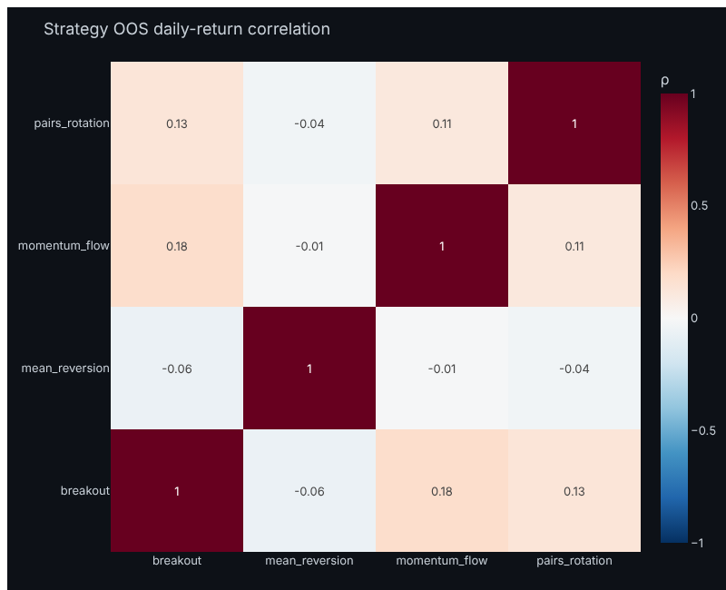
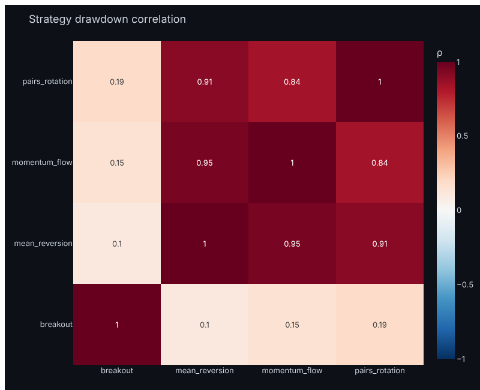
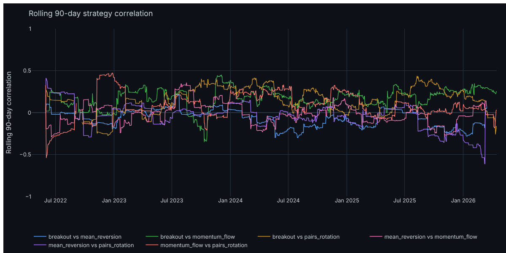

# Strategy Correlation & Diversification Report

Correlations are computed on stitched OOS daily returns (days with no position count as 0 return). Different indicators do **not** imply low correlation; this report measures it.

### Daily return correlation

| | breakout | mean_reversion | momentum_flow | pairs_rotation |
|---|---|---|---|---|
| breakout | 1.00 | -0.06 | 0.18 | 0.13 |
| mean_reversion | -0.06 | 1.00 | -0.01 | -0.04 |
| momentum_flow | 0.18 | -0.01 | 1.00 | 0.11 |
| pairs_rotation | 0.13 | -0.04 | 0.11 | 1.00 |

### Drawdown correlation

| | breakout | mean_reversion | momentum_flow | pairs_rotation |
|---|---|---|---|---|
| breakout | 1.00 | 0.10 | 0.15 | 0.19 |
| mean_reversion | 0.10 | 1.00 | 0.95 | 0.91 |
| momentum_flow | 0.15 | 0.95 | 1.00 | 0.84 |
| pairs_rotation | 0.19 | 0.91 | 0.84 | 1.00 |

### Correlation on down days of the equal-weight portfolio

| | breakout | mean_reversion | momentum_flow | pairs_rotation |
|---|---|---|---|---|
| breakout | 1.00 | -0.04 | -0.24 | 0.10 |
| mean_reversion | -0.04 | 1.00 | 0.01 | -0.02 |
| momentum_flow | -0.24 | 0.01 | 1.00 | -0.14 |
| pairs_rotation | 0.10 | -0.02 | -0.14 | 1.00 |

### Risk contribution (equal weights)

| strategy | share_of_variance |
|---|---|
| breakout | 19.87% |
| mean_reversion | 2.05% |
| momentum_flow | 74.34% |
| pairs_rotation | 3.74% |

### Rolling 90-day correlation summary

| pair | mean | min | max | last |
|---|---|---|---|---|
| breakout|mean_reversion | -0.070 | -0.299 | 0.223 | 0.072 |
| breakout|momentum_flow | 0.172 | -0.350 | 0.450 | 0.251 |
| breakout|pairs_rotation | 0.149 | -0.272 | 0.436 | -0.161 |
| mean_reversion|momentum_flow | -0.017 | -0.289 | 0.356 | 0.079 |
| mean_reversion|pairs_rotation | -0.044 | -0.612 | 0.411 | 0.016 |
| momentum_flow|pairs_rotation | 0.080 | -0.540 | 0.474 | 0.028 |

Highly correlated pairs (ρ > 0.7): none

